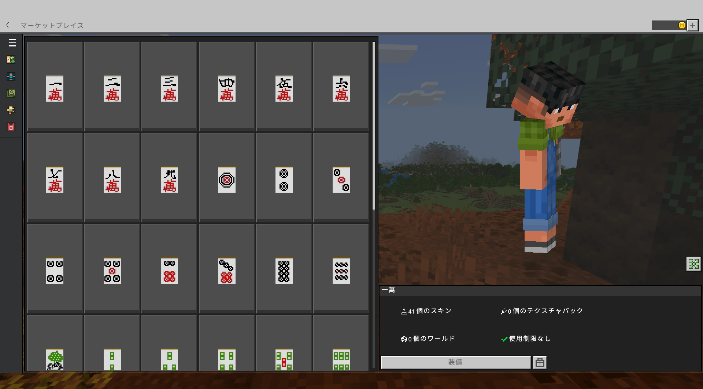

# Mahjong-skin

Minecraft Bedrock Edition 用の麻雀牌スキンパックです。



## 作者

- スキンパック作成: [MomokaSada](https://github.com/MomokaSada)
- スキンデザイン・画像: ばなな星人 ([@bananaseizin621](https://x.com/bananaseizin621))

## インストール

1. [Releases](https://github.com/MomokaSada/Mahjong-skin/releases) から `Mahjong-skin.mcpack` をダウンロード
2. ダブルクリックで Minecraft にインポート

## リリースの作り方

`v1.0.0` のようなタグを push すると、GitHub Actions が `skinpack/` を zip して `.mcpack` を生成し、Release に添付します。

```bash
git tag v1.0.0
git push origin v1.0.0
```